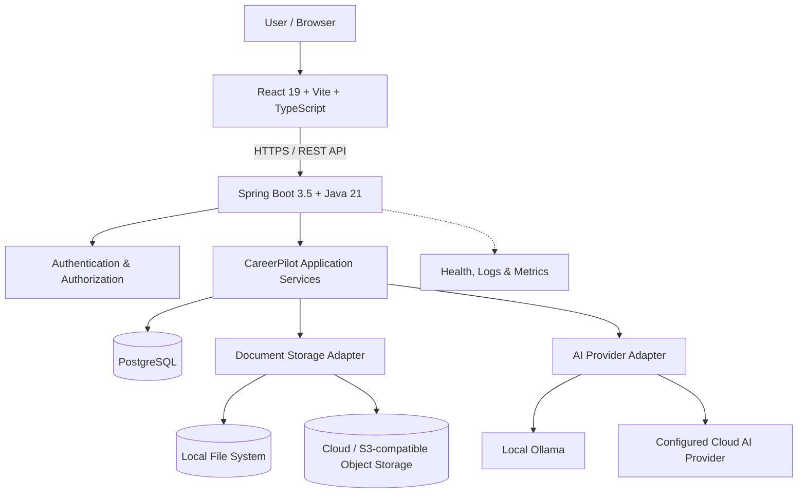

# CareerPilot AI — Target Architecture

**Status:** Proposed architecture approved for documentation; implementation is gated on review.  
**Last updated:** 2026-11-07  
**Scope:** Deployment-independent target architecture for a multi-user application. This document describes intended design, not completed functionality.

## 1. Architecture decisions

| Concern | Decision | Implication |
|---|---|---|
| Deployment priority | **All modes** — local, self-hosted, and cloud | One codebase and consistent application behavior across environments |
| Document storage | **Hybrid** — local disk and cloud/object storage | Select the storage adapter through environment configuration |
| AI provider | **Switchable** — local Ollama and cloud AI providers | Keep provider-specific APIs behind a common application interface |
| Application tenancy | **Multi-user** | Each authenticated user can access only their own records and documents |
| Relational database | PostgreSQL as the common database baseline | Use PostgreSQL in local, self-hosted, and cloud deployments to reduce environment drift |

Specific hosting vendors, object-storage vendors, AI vendors beyond the local Ollama option, and authentication implementation details remain open until their respective design gates.

## 2. High-level architecture

The frontend communicates only with the backend API. The backend owns authentication, authorization, business rules, persistence, document access, and AI-provider orchestration. Provider adapters isolate infrastructure choices from product features.

The diagram shows target components. It does not imply that authentication, persistence, storage adapters, AI integration, or observability beyond the existing health endpoint are already implemented.

## 3. Application components

### Frontend
- React 19, Vite, and TypeScript.
- Calls backend APIs; it must not connect directly to PostgreSQL, document storage credentials, or AI provider secrets.
- Uses environment-specific API configuration without embedding secrets in the browser bundle.

### Backend
- Java 21 and Spring Boot 3.5.x with Maven.
- Exposes the REST API and owns business logic.
- Enforces authentication and per-user authorization at the service/data access boundary.
- Integrates with persistence, document storage, and AI through interfaces/adapters.
- Keeps provider credentials on the server and out of frontend code and logs.

### Database
- PostgreSQL is the common relational database across deployment modes.
- User-owned records must carry an ownership relationship, and queries/mutations must enforce it.
- Database schema changes will be versioned and repeatable through a migration tool selected before persistence implementation.
- Local development may use PostgreSQL in Docker Compose or a native PostgreSQL installation; Docker is a convenience, not a hard runtime dependency.

### Document storage — hybrid
Define a storage interface so product services do not depend on a vendor or filesystem API directly.

- **Local adapter:** stores files on a configured local data directory.
- **Object-storage adapter:** stores files in a configured S3-compatible or equivalent object store.
- Select the adapter and location through backend environment configuration.
- Store file metadata and ownership in PostgreSQL; do not expose raw storage paths or unrestricted object URLs.
- Authorize every upload, download, replacement, and deletion against the owning user.
- Keep private files outside public frontend assets and static web roots.
- Backups, retention, file-size limits, content validation, and malware scanning policy must be defined before production use.

### AI integration — switchable
Define a common AI interface for application features.

- **Local option:** Ollama, reachable by the backend in the local or self-hosted environment.
- **Cloud option:** a configured cloud AI provider accessed server-side.
- Select provider/model through environment configuration; keep provider-specific settings in adapters.
- Do not send user documents or personal data to an external provider without clear user-facing disclosure and an appropriate data-handling policy.
- Handle provider timeouts, rate limits, unavailable models, and malformed responses.
- AI output is advisory. Users remain responsible for reviewing career materials and approving consequential actions.

## 4. Deployment modes

All modes run the same application artifacts. Differences are configuration and infrastructure, not separate product forks.

| Mode | Frontend | Backend | Database | Documents | AI |
|---|---|---|---|---|---|
| Local | Local development server or local static build | Local Spring Boot process/container | Local PostgreSQL | Local disk | Ollama or configured cloud provider |
| Self-hosted | Served locally or through a reverse proxy | Self-hosted Spring Boot process/container | Self-hosted PostgreSQL | Local disk or configured object storage | Ollama or configured cloud provider |
| Cloud | Static frontend hosting/CDN | Hosted Spring Boot service/container | Managed PostgreSQL | Configured object storage | Configured cloud provider; Ollama only where reachable and intentionally operated |

A local installation is not automatically reachable from the public internet. Remote access requires deliberate network configuration, HTTPS, and appropriate firewall/reverse-proxy controls. A cloud deployment is not automatically free or permanently available on a provider's free tier.

## 5. Configuration strategy

Use Spring profiles for environment-specific defaults and environment variables/secrets for deployment-specific values. Keep safe examples in version control; never commit real credentials.

Planned profile names:
- `local`
- `selfhosted`
- `cloud`

Illustrative backend settings (names are design examples and may be refined during implementation):

| Setting | Purpose |
|---|---|
| `SPRING_PROFILES_ACTIVE` | Select deployment profile |
| `DATABASE_URL`, `DATABASE_USERNAME`, `DATABASE_PASSWORD` | PostgreSQL connection |
| `STORAGE_PROVIDER` | Select local or object storage adapter |
| `STORAGE_LOCAL_ROOT` | Local private document directory |
| `STORAGE_ENDPOINT`, `STORAGE_BUCKET` | Object storage destination |
| `STORAGE_ACCESS_KEY`, `STORAGE_SECRET_KEY` | Object-storage credentials |
| `AI_PROVIDER` | Select Ollama or cloud adapter |
| `OLLAMA_BASE_URL`, `OLLAMA_MODEL` | Local AI endpoint and model |
| `AI_API_KEY`, `AI_MODEL` | Cloud AI credentials and model |

Exact property names, validation rules, secret management, and profile files will be finalized during implementation. Frontend configuration may contain public API base URLs only; it must never contain database, storage, or AI secrets.

## 6. Multi-user security and privacy boundaries

Multi-user support is a core design requirement, not a later hosting feature.

- Every private business record and document must be associated with an owner.
- Authorization must be enforced by the backend on every read and write; hiding UI controls is not security.
- A user must not be able to access another user's data by changing an identifier, URL, filename, or request payload.
- Use secure password handling and established authentication mechanisms; select the exact session/token design before implementing authentication.
- Apply least privilege to database and storage credentials.
- Use HTTPS for remote deployments; secure cookies/tokens and CSRF protections must match the chosen authentication model.
- Avoid logging passwords, tokens, resume contents, contact details, or other sensitive personal data.
- Define account deletion, data export, retention, and backup/restore behavior before public release.
- Add automated tests for cross-user access attempts and authorization failures.

## 7. Operational and cost principles

- Keep the application runnable locally without a paid service.
- Treat free cloud tiers as optional deployment targets, not guaranteed production infrastructure.
- Do not couple the codebase to one hosting vendor.
- Provide health checks and structured, privacy-safe logs.
- Document database and document backup/restore procedures before production use.
- Make resource-intensive or externally billed AI providers opt-in and configurable.

## 8. Review gates and open decisions

The deployment, storage, and AI strategy decisions in Section 1 are approved. Before implementation begins, review and confirm:

1. This architecture and the Mermaid component diagram.
2. The exact authentication approach and account lifecycle.
3. PostgreSQL version, migration tool, and local setup method.
4. File limits, allowed formats, retention, backup, and malware-scanning policy.
5. Initial AI provider adapter contract and data-disclosure behavior.
6. The first deployment target used for validation; support for all modes remains the architectural goal.
7. Secrets management, HTTPS, logging, monitoring, and restore expectations for a public multi-user deployment.

**Implementation gate:** Do not begin the next application-code milestone until this document and its open decisions have been reviewed. Approval of the high-level direction does not automatically approve unresolved security or operational details.
